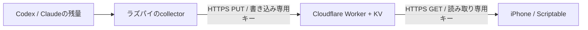

# AI Usage Widget

Codex・Claudeのサブスク残量を、iPhoneのScriptableウィジェットに並べて表示します。
数値とバーは両方とも **残りの割合（100 − 使用率）** です。

ラズパイが取得、Cloudflare Workers + KVが保存・配信、iPhoneが表示を担当します。
モデルへのプロンプト送信や推論は行いません。



## ソース構成

| パス | 役割 |
| --- | --- |
| `collector.py` | Codex App Server・Claudeの使用量情報を取得し、表示用データだけを送信 |
| `cloudflare/worker.mjs` | キーを検証してKVへ保存・読み取りするWorkerテンプレート |
| `scriptable/AI Usage.js` | 余白を減らした中サイズウィジェット。残り％・リセット時刻・取得時刻を表示 |
| `scriptable/AI Usage Circle.js` | 同じ機能の円形メーター版。元の横棒版と併用可能 |
| `systemd/` | ラズパイの定期実行用user service / timer |
| `scripts/prepare-local.py` | Git管理外のキーとデプロイファイルを生成 |
| `tests/` | Workerの認証・入力検証と、Scriptableの通信エラー・再設定の検証 |

## キーと認証情報

実際の読み取りキー、書き込みキー、OAuth認証ファイル、利用状況のキャッシュ、生成済みWorkerは含めていません。
CloudflareアカウントID・KV名前空間IDは設定例のプレースホルダーです。
Scriptableの配信先URLは公開の接続先であり、残量の読み取りには別途キーが必要です。

- **読み取りキー**: iPhoneのScriptable Keychainに保存。
- **書き込みキー**: ラズパイの所有ユーザーだけが読める`config.json`に保存。
- **Codex・Claudeの認証情報**: ラズパイに保存。Cloudflareへ送信しません。
- **Worker**: 検証用SHA-256ハッシュのみを生成コードに埋め込みます。
- `.local/`、`config.json`、認証ファイル、実行状態は`.gitignore`で除外します。

`collector.py`内のOAuthクライアントIDは公式CLIに含まれる公開識別子であり、個人の認証トークンではありません。
このリポジトリのコードを更新しても、稼働中のサーバーやiPhoneには自動反映されません。

## Cloudflareの準備

Python 3.9以上を使って、Git管理外の設定を生成します。

```sh
python3 scripts/prepare-local.py
```

生成される`.local/`内のファイルはコミットしないでください。再実行しても既存のキーは保持します。

1. Cloudflareに専用WorkerとKV名前空間を用意します。
2. `.local/wrangler.jsonc`のアカウントIDとKV名前空間IDを設定します。KVバインディング名は`USAGE`です。
3. Wranglerでログインし、生成済みWorkerをデプロイします。

```sh
npx wrangler login
npx wrangler deploy --config .local/wrangler.jsonc
```

| API | 認証 |
| --- | --- |
| `GET /health` | 不要。稼働確認だけを返す |
| `GET /v1/usage` | 読み取りキー |
| `PUT /v1/usage` | 書き込みキー |

読み取りキーでの書き込み、書き込みキーでの読み取りは拒否します。
保存時に項目を絞り、余分な情報は除去します。

## ラズパイの準備

必要な環境はPython 3.9以上、動作するCodex CLI、systemdです。Python外部パッケージは不要です。

1. `~/ai-usage-widget/`を作成し、`collector.py`を配置します。
2. `.local/collector-config.json`の配信先・Codex実行ファイル・Claude認証ファイルの絶対パスを設定し、ラズパイでは`config.json`として配置します。
3. `config.json`と認証ファイルの権限を`600`、親ディレクトリを`700`にします。
4. Codex CLIでサブスクへログインします。

```sh
codex login --device-auth
python3 collector.py --dry-run --force
```

Claudeは監視専用のログインを使用します。LinuxまたはWSLの例:

```sh
CLAUDE_CONFIG_DIR="$HOME/.claude-usage-widget" claude auth login
```

専用プロファイルの`.credentials.json`を安全にラズパイへ移し、`claudeCredentials`に絶対パスを設定します。
専用認証であることを確認してから`claudeDedicatedAuth`を`true`にすると、自動更新を有効にします。
この認証を普段使いのClaude Codeと共有すると更新が競合し得るため、監視専用にします。
再認証後は`--force`で待機時間を無視して再取得できます。

```sh
python3 collector.py --force
```

`systemd/`の2ファイルを`~/.config/systemd/user/`へ置き、次で定期実行を有効にします。

```sh
systemctl --user daemon-reload
sudo loginctl enable-linger "$USER"
systemctl --user enable --now ai-usage-widget.timer
```

通常は約5分間隔、失敗時は間隔を延長します。HTTP 429ではRetry-Afterを尊重します。
前回成功値・取得時刻はサービスごとに保持します。

停止:

```sh
systemctl --user disable --now ai-usage-widget.timer
```

## iPhoneへの導入

1. Scriptableに`scriptable/AI Usage.js`を追加します。別の配信先を使う場合は先頭の`ENDPOINT`を変更します。
2. アプリ内で実行し、`.local/reader-key.txt`の43文字のキーを入力します。
3. ホーム画面にScriptableの中サイズを追加し、スクリプトを選択します。
4. `When Interacting`は`Run Script`、`Parameter`は空欄にします。

既存のスクリプト本文を差し替えても、同じKeychain名を使うため保存済みのキーを引き継ぎます。
円形メーター版を使う場合は、`AI Usage Circle.js`を別名のスクリプトとして追加し、一度実行します。
ウィジェットを長押し → ウィジェットを編集 → Scriptで、`AI Usage`（横棒）と`AI Usage Circle`（円形）を切り替えられます。
両方とも同じ読み取りキーとキャッシュを使い、残りの割合を表示します。Parameterは空欄です。
401はキー不一致、403はアクセス拒否、通信エラーは接続の失敗として表示し、アプリ内でキーを再設定できます。
キーやサーバーの生レスポンスはエラー画面に出しません。

## 検証

Node.js 20以上で、外部通信・秘密情報を使わずにテストできます。

```sh
npm test
```

## 動作上の制約

- iPhoneの更新タイミングはiOSが調整します。ラズパイの更新間隔と一致する保証はありません。
- Cloudflare KVは拠点間で反映が遅れる場合があります。
- Claudeの使用量・認証更新エンドポイントは外部連携向けの仕様保証がないため、変更時には対応が必要です。
- リセット予定時刻を過ぎても、再取得するまでは残量を勝手に100%へ変更しません。
- 内部コード名の`iguana_necktie`は取得結果から除外し、表示しません。
